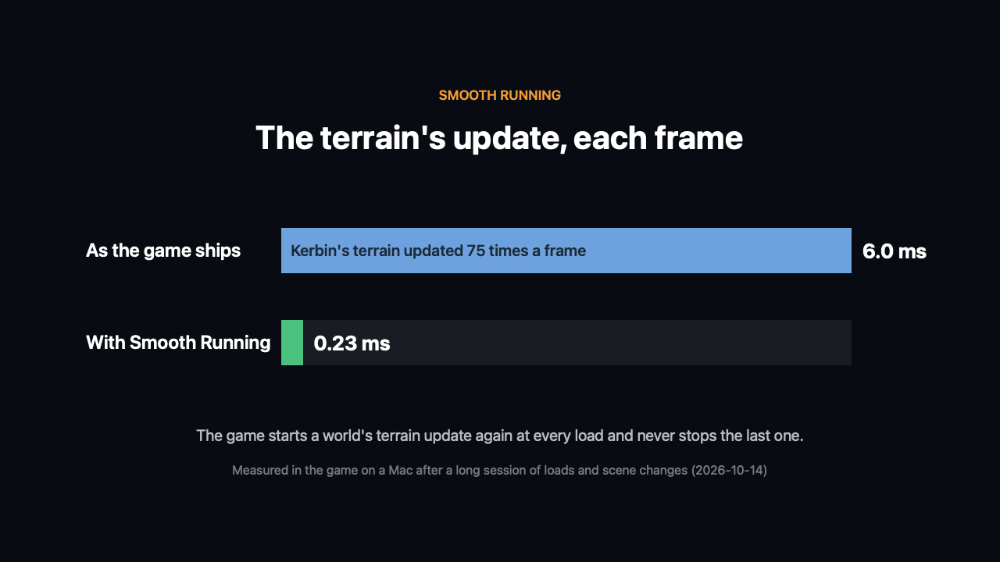
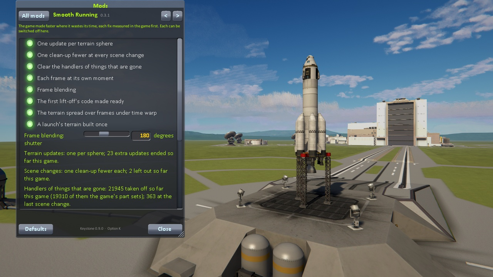

# Smooth Running

The game made faster where it wastes its time, each fix measured in the game first.

For Kerbal Space Program 1.12.x. **Needs [Keystone](https://github.com/IshiakiZ/ksp-keystone) 0.9 or later** ([on SpaceDock](https://spacedock.info/mod/4665/Keystone))
and **Harmony** (HarmonyKSP), both separate downloads: this mod changes some of the game's own code as it runs (nothing on
disk), and does not load without them.

## What it mends

* **The terrain's update, once per world.** The game starts a world's terrain update again at every load, every scene
  change and every revert, and never stops the last one: after an evening of play Kerbin's terrain was being updated 75
  times a frame, 6 ms of every frame on a Mac. It ends the extra copies. (KSP Community Fixes mends the same flaw in its
  own way; with it installed this changes nothing.)
* **Handlers of things that are gone, cleared** (0.2.0). Every scene change left some 420 more handlers on the game's
  events: things already destroyed, and the game's records of which parts share resources, which never take
  themselves off and keep the parts of craft long gone in memory. They are cleared at every scene change: 363 at one
  change here.
* **One clean-up fewer at every scene change** (0.2.0). Unity goes through everything loaded for things no longer used
  three times, a fifth of a second each; the second, asked for by the game right after Unity's own, never finds
  anything, and is left out.

* **Each frame at its own moment** (0.3.0). The game moves everything in steps of a fiftieth of a second and draws
  what the last step left; frames do not come every fiftieth, so some carry two steps and some one, and the world on
  screen goes in jumps. With this on, every craft (and the camera with the one it follows) is drawn where it has got to
  by the moment the frame is drawn, and put back after: physics never sees it. Measured flying at 260 m/s low over the
  sea at 31 frames a second, the judder (how unevenly the ground crosses the screen) went from 0.31 to 0.07.

* **Frame blending** (0.3.0). Each frame blended along the way each thing in it moved while the frame was "exposed",
  as a film camera's shutter blends it: at a low frame rate the jumps between frames read as motion, not as a string of
  stills. The ground and sky stream past; the craft the camera follows moves with it and stays sharp. At sixty frames a
  second it is slight, at ten long; a switch and the shutter's angle on its page.

* **The first lift-off's code made ready** (0.3.0). The game compiles its code the first time it runs, and a game's
  first lift-off runs some 140 of the game's own methods for the first time: 11 ms of compiling, in the two slowest
  frames of a flight. They are compiled a few seconds into the first flight scene instead, a little in each frame; the
  lift-off's frames then compile none of them.

* **The terrain spread over frames under time warp** (0.3.0). The game lets a world's terrain take up to a tenth of a
  second of any frame, and under warp, the ground racing by, it does at every change of the rate. While time is warped on
  rails it takes at most 8 ms a frame: in a round of warp from orbit the frames over a tenth of a second went from 4 to none.

* **A launch's terrain built once** (0.3.0). Setting a new craft on the pad, the game builds the ground round it and then
  throws that away and builds it again. The second time is left out: a launch from the space centre a second sooner (8.1
  to 8.5 s down to 7.2 to 7.4 here).

More to come, each only after it has been measured.

## Install

Copy the `SmoothRunning` folder from the download into your KSP's `GameData`, beside `Keystone` and Harmony's `000_Harmony`.

## Use

It is on as installed. In the Keystone window (the keystone button on the game's toolbar, or Alt-K; Option-K on a Mac),
under **Smooth Running**: a switch for each fix, and what each has done this game.

## Works on

Mac: tried. Windows 11 (Direct3D 11 and OpenGL): run 2026-10-20, its frame blending's shader built for Direct3D and loaded on
both; a launch filmed on each with no doubled rocket. Linux: never run.

## Licence

[CC BY 4.0](LICENSE): use it, change it and pass it on as you like, as long as you credit Ishiaki and link back here.
